# TAREEQ — Martian Map Mission Planner

TAREEQ is a Mars-mapping and route-planning prototype for NASA Space Apps Challenge 2026's **Interplanetary Survival Guide: Martian Map** challenge. It combines a global 3D Mars view, a 2D map with selectable layers and distance measurement, and a mission workflow that compares Greedy Best-First, Uniform-Cost Search (UCS), and A* routes.

For routes wholly inside the verified Jezero data footprint, the planner and mission view can use a matching **20 m CTX digital terrain model** and **6 m grayscale CTX orthophoto**. Outside Jezero, the app falls back to the much coarser global MOLA grid and warns that it is not suitable for rover-scale hazards. The mission view displays the selected route, a moving Curiosity 3D model, camera-follow behavior, and a route minimap. It is a demonstration prototype, not a certified rover-navigation or hazard-avoidance system.

**NASA Space Apps team profile:** [TAREEQ](https://www.spaceappschallenge.org/2026/find-a-team/tareeq/)

## Run the project from GitHub

### Requirements

- Git, to clone the repository.
- Node.js 22 LTS. The Node.js installer also installs npm; you do not install npm separately.
- A modern browser with WebGL enabled.
- An internet connection for NASA Mars Trek imagery and the first dependency installation. The core DEM files are included in the repository.

### Clone and start the development server

Open PowerShell, Command Prompt, Terminal, or another shell and run:

```sh
git clone https://github.com/Elzadey/TAREEQ-Martian-Map-Intelligent-Navigation-for-Mars-Exploration.git TAREEQ-Martian-Map
cd TAREEQ-Martian-Map/frontend
npm ci
npm start
```

When the development server is ready, open **http://localhost:3000**. Keep the terminal open while using the app; press **Ctrl+C** in that terminal to stop it.

### What `git clone` and `npm ci` do

`git clone` downloads the repository's tracked source files and Git history into a new `TAREEQ-Martian-Map` folder. It does **not** install Node.js, npm, the project's JavaScript packages, or start the application. Install Git and Node.js before running the commands above.

`npm ci` reads `frontend/package-lock.json` and installs the exact JavaScript dependencies into `frontend/node_modules` (including React, CesiumJS, OpenLayers, and TypeScript). It also runs the project's post-install script, which prepares Cesium's static browser assets. `node_modules` is generated locally, is not committed to GitHub, and does not need to be uploaded. If dependency installation fails, check your internet connection and Node.js version, then rerun `npm ci` from the `frontend` directory.

`npm start` launches the local React development server; it does not publish the project to the internet. Anyone who clones the public repository can follow these same steps on their own computer.

## Build and test

Run these commands from `frontend` after `npm ci`:

```sh
npm run type-check
npm test -- --watchAll=false --runInBand
npm run build
```

The production site is generated in `frontend/build/`. That folder is intentionally ignored by Git because it is generated output; create it locally with `npm run build`, then deploy the **contents** of `frontend/build/` to a static web host. Keep the `cesium/`, `data/`, and `models/` folders when deploying. The core frontend does not require the repository's optional Python backend.

To omit source maps from a production build, use the appropriate shell syntax first:

```powershell
# PowerShell
$env:GENERATE_SOURCEMAP = "false"
npm run build
```

```cmd
:: Command Prompt
set "GENERATE_SOURCEMAP=false"
npm run build
```

For a prebuilt ZIP release, `RUN-BUILT-TAREEQ-Windows.bat` serves the included production build locally. A normal Git clone does not contain that generated build, so build it first or use `npm start` for development.

## Main workflow

1. Open the global 3D view, then switch to **2D MAP** to inspect layers and measure between points.
2. Open **START MISSION**, choose a start and destination on Mars, and compare A*, Uniform-Cost Search, and Greedy Best-First results.
3. Select a route and start the mission. Inside the verified Jezero footprint, the app uses the CTX DTM and matching orthophoto, animates the Curiosity model with camera-follow, and shows the route minimap plus an elevation profile sampled from the source DEM. The profile is labelled as areoid-referenced data; keyboard and on-screen controls are available.

The algorithms optimize different objectives: A* combines terrain-weighted route cost with a goal heuristic; UCS expands by accumulated route cost; Greedy prioritizes estimated closeness to the destination and is not guaranteed to find the lowest-cost route. Their distances or search effort may differ, but identical route distances can occur for some endpoint pairs.

For the tested Jezero A* demo, see the [route coverage report](ROUTE-COVERAGE-REPORT.md) and its [92-point raw CTX elevation profile](reports/jezero-astar-route-profile.csv). The diagnostic reports the DTM/orthophoto overlap, route bounds, coverage percentage, and missing segments.

The screenshot below is a local Chromium verification capture of the regional mission scene, not a generated terrain image.

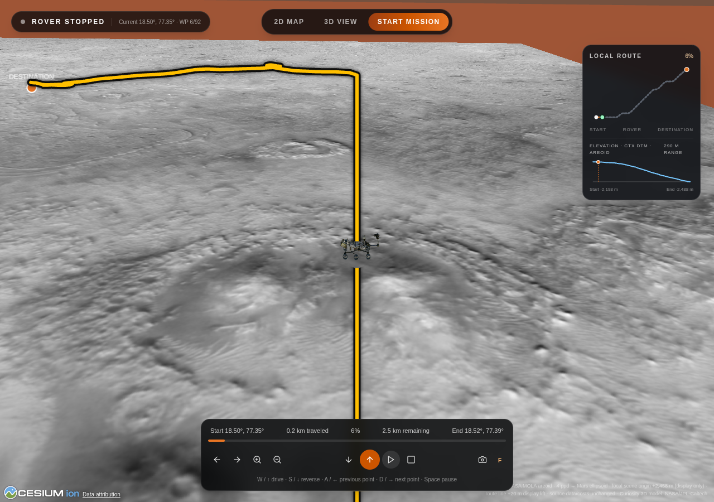

## Project screenshot gallery

These team-provided screenshots document the global map, measurement tools, layer controls, route-planning interface, and the TAREEQ team page. The route-comparison screenshots are intermediate UI captures; the verified Jezero mission scene above and the coverage report describe the current release state.

### Global 3D and 2D views

<table>
  <tr>
    <td width="50%">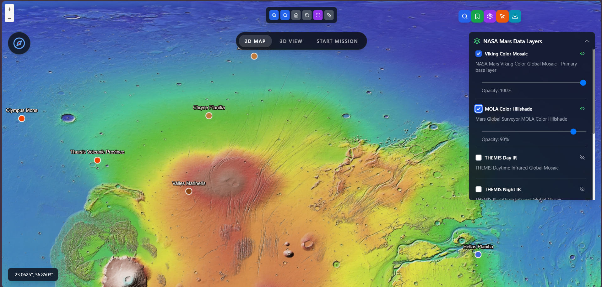</td>
    <td width="50%">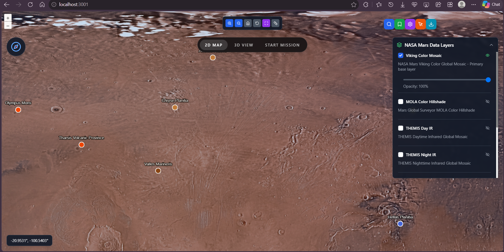</td>
  </tr>
  <tr>
    <td width="50%">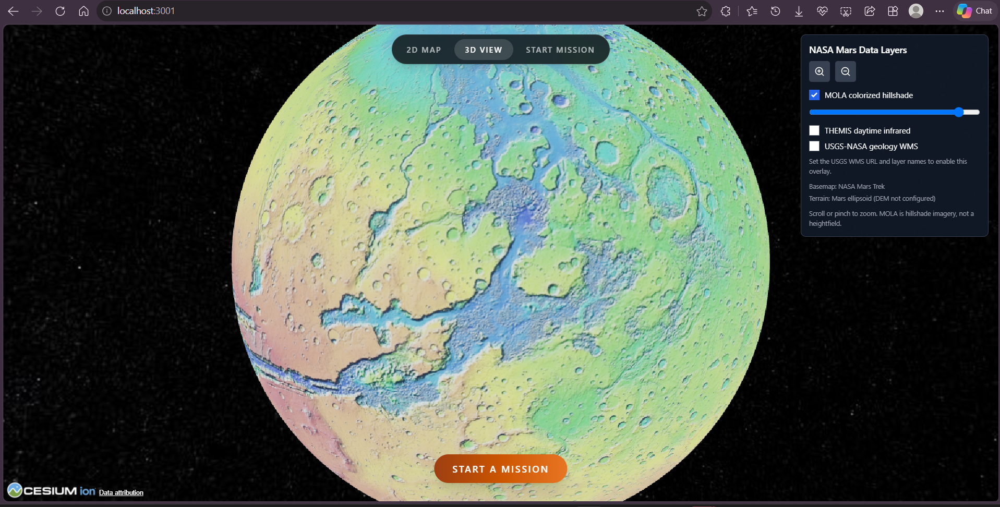</td>
    <td width="50%">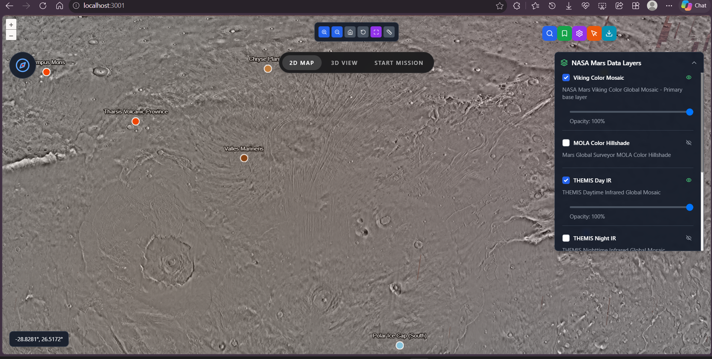</td>
  </tr>
  <tr>
    <td width="50%">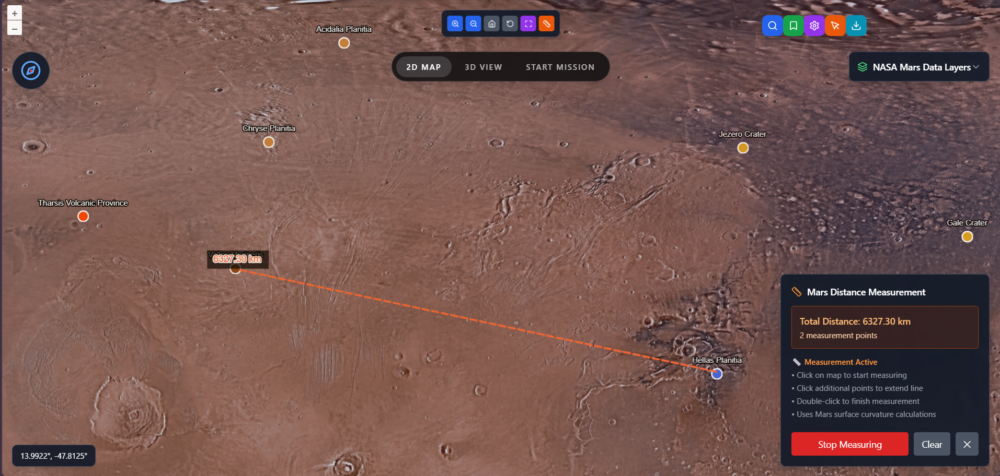</td>
    <td width="50%">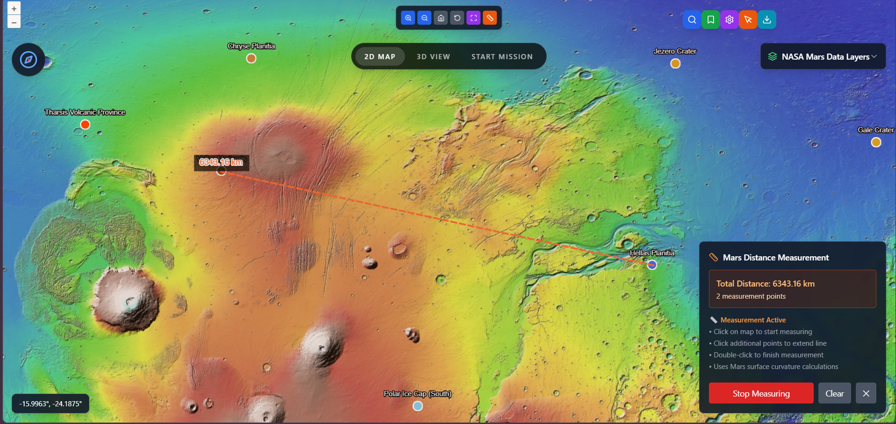</td>
  </tr>
</table>

### Map layers and controls

<table>
  <tr>
    <td width="33%">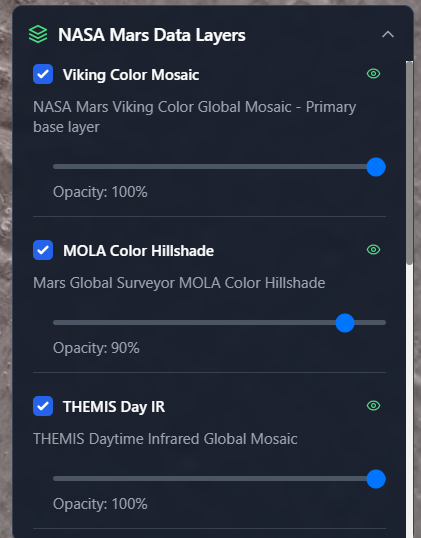</td>
    <td width="33%">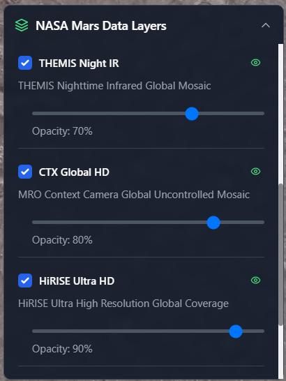</td>
    <td width="33%">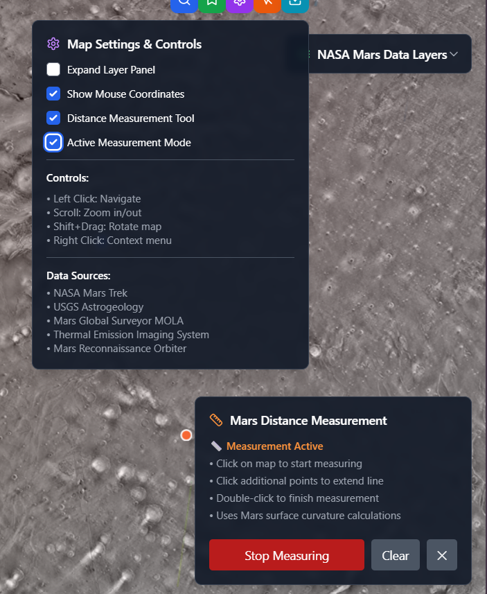</td>
  </tr>
</table>

### Route-planning interface

<table>
  <tr>
    <td width="50%">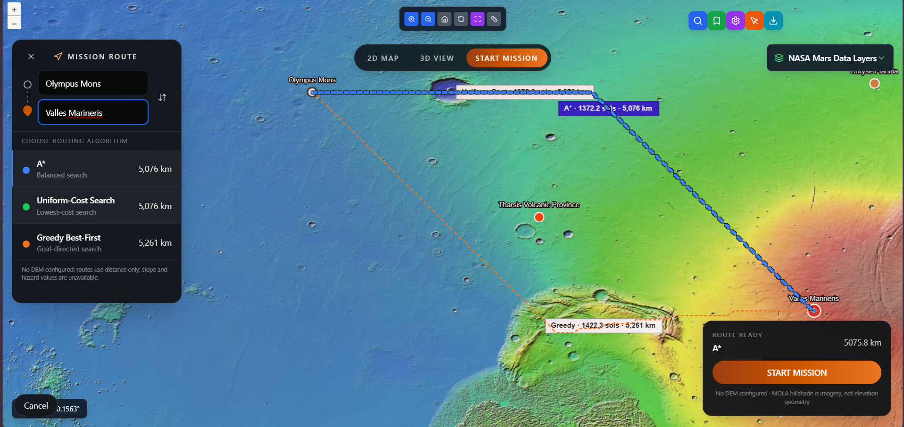</td>
    <td width="50%">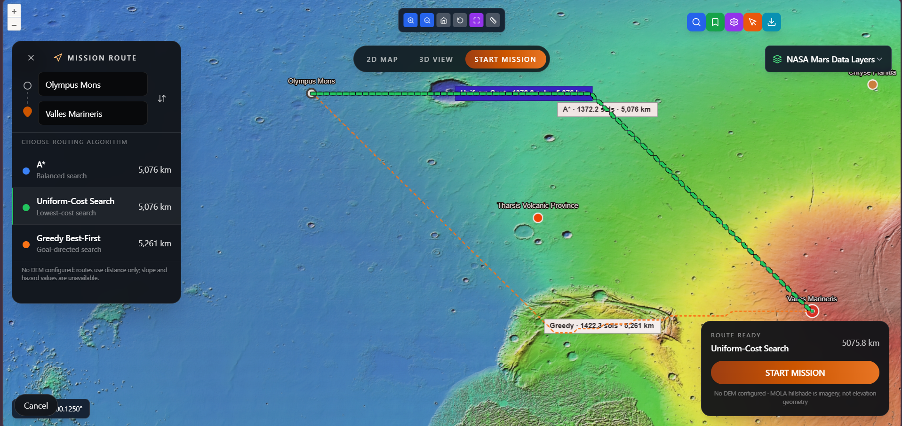</td>
  </tr>
  <tr>
    <td width="50%">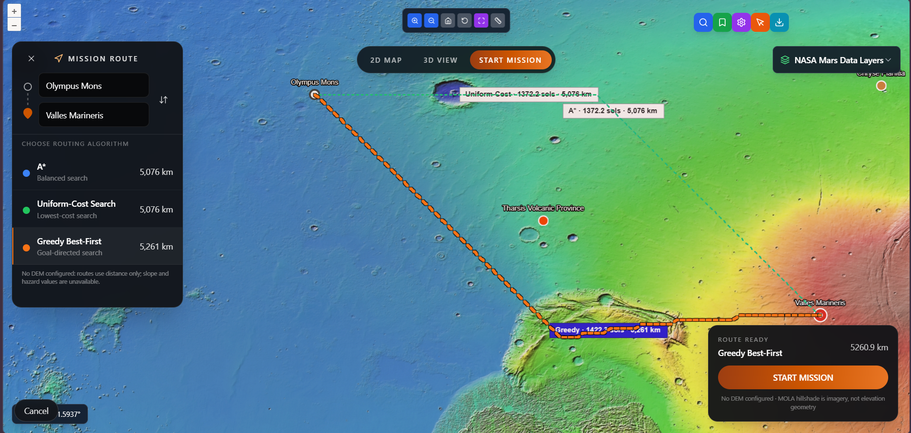</td>
    <td width="50%"></td>
  </tr>
</table>

### NASA Space Apps team page

[Open TAREEQ's team profile on NASA Space Apps Challenge 2026](https://www.spaceappschallenge.org/2026/find-a-team/tareeq/).

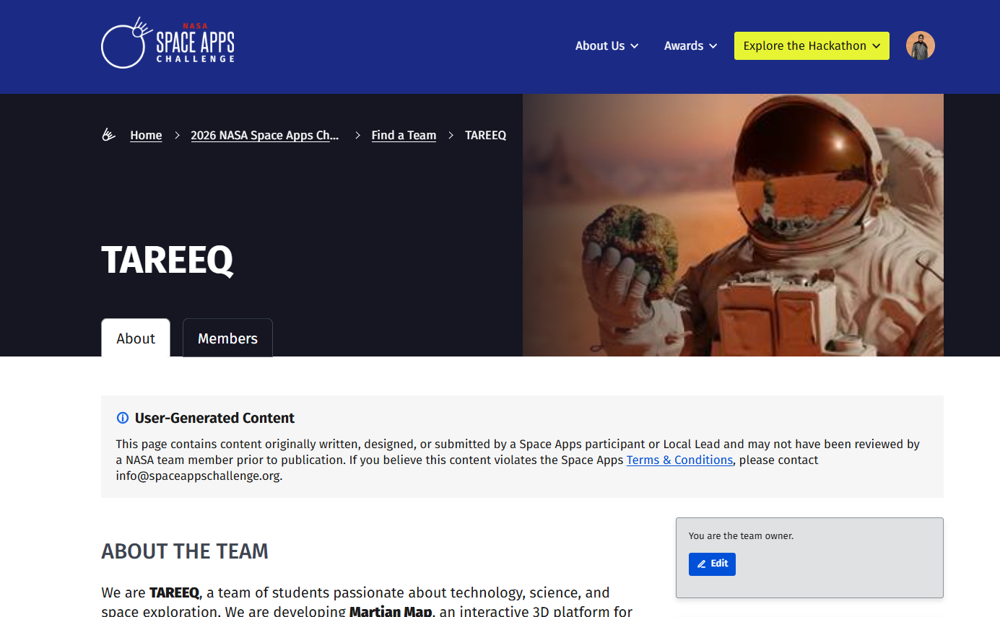

## Data and credits

| Resource | Use | Coverage / resolution |
|---|---|---|
| NASA/PDS MGS MOLA MEGDR | Global numeric elevation grid and coarse terrain context | 4 samples per degree; approximately 14.8 km per cell at the equator |
| NASA/PDS MOLA areoid grid | Vertical-datum conversion for Cesium Mars ellipsoid heights | 4 samples per degree; paired with the bundled MOLA grid |
| USGS Astrogeology / NASA Mars 2020 CTX Jezero DTM | Regional elevation sampling and mission terrain | 20 m; Jezero footprint only |
| Matching Jezero CTX orthophoto | Regional surface image | 6 m grayscale; aligned with the CTX DTM |
| NASA Mars Trek | Optional global imagery layers, including Viking and MOLA products | Requires internet access; image layers are not numeric elevation data |
| Curiosity rover model | 3D mission visualization | Credited to NASA/JPL-Caltech; see `frontend/public/models/README.md` |

The source GeoTIFFs, coverage metadata, and the reproducible preparation script are included under `data/source/jezero/` and `tools/`. Rebuilding the processed regional browser assets requires Python 3, `rasterio`, `numpy`, and `Pillow`; from the repository root run:

```sh
python -m pip install rasterio numpy Pillow
python tools/prepare_regional_mars_data.py
```

## Known limitations

- The high-resolution regional dataset covers Jezero only. Outside it, the MOLA fallback is too coarse to identify rocks, wheel-scale obstacles, or safe rover paths.
- The mission view is a functional prototype, but its surface rendering is not yet at the visual quality of the NASA game-style reference.
- CTX and MOLA topography are referenced to the MOLA areoid. The app bundles the NASA/PDS MOLA areoid grid and converts rendered elevations to Mars ellipsoid heights for Cesium. During a regional Jezero mission, global image overlays are suspended so the matching CTX orthophoto remains visible, then restored on exit. A computed route-local scene origin, a 20 m route-line display lift, and the camera-projected route highlight are rendering-only; they do not change source DEM values, route costs, or geographic coordinates. The rover is placed 0.25 m above the converted surface to account for its model origin. The elevation profile displays raw areoid-referenced samples, not the rendering offsets.
- The bundled Jezero pair is the 20 m CTX DTM and matching 6 m orthophoto. Higher-resolution HiRISE products are documented in the dataset audit but are not bundled here; do not imply that they are used by this build.
- TAREEQ is not safety-certified and does not currently model all mission hazards, including radiation, weather, or rover-scale obstacles.

## Repository layout

```text
frontend/                React + TypeScript application
frontend/public/data/    Bundled MOLA and processed Jezero CTX data
frontend/public/models/  Curiosity 3D model and attribution
data/source/jezero/      Original matching CTX source GeoTIFFs
docs/screenshots/        Team-provided product and NASA team-page screenshots
tools/                    Data preparation utility
reports/                  Per-waypoint raw CTX elevation profile CSV
verification/             Chromium screenshot of the tested mission scene
ROUTE-COVERAGE-REPORT.md  Dataset overlap, route bounds, and coverage results
```

For additional Windows, Docker, and hosting instructions, see [`DEPLOYMENT-AR.md`](DEPLOYMENT-AR.md). All project sources and external datasets are credited in the relevant README files.
