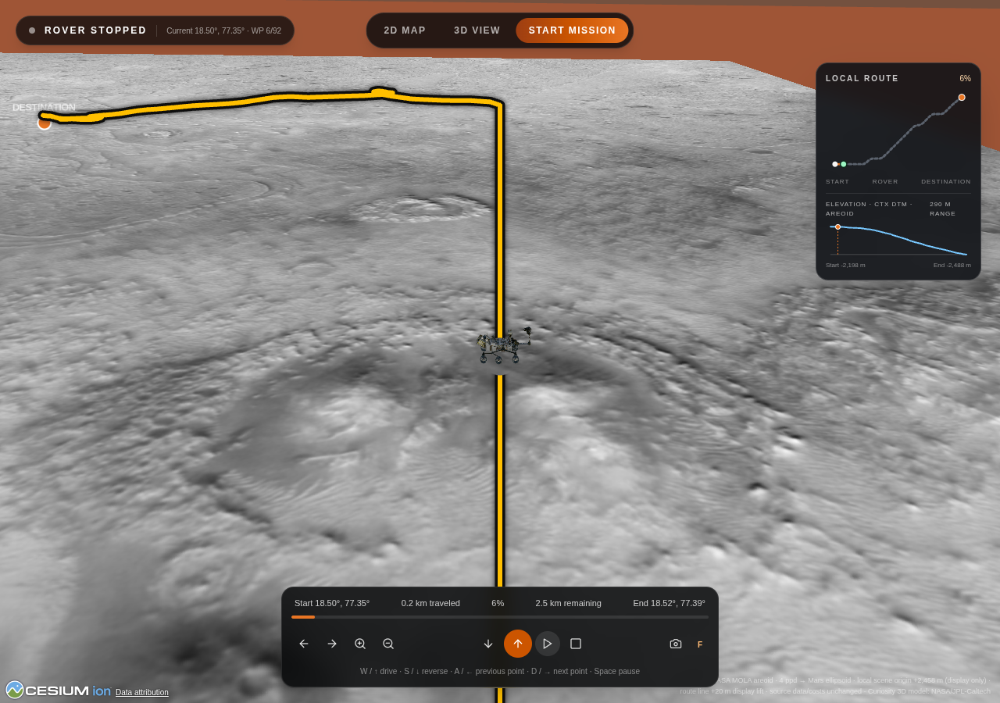

# تقرير تغطية مسار Jezero التجريبي وملف الارتفاع

- **التاريخ:** 14 نوفمبر 2026
- **المسار المختبر:** Jezero delta-slope demo باستخدام A* من التطبيق نفسه
- **النتيجة:** المسار كاملًا داخل التقاطع المكاني بين CTX DTM وCTX orthophoto؛ لا توجد نقاط أو مقاطع خارج التغطية.

## 1. نطاق البيانات والتحقق من CRS

| الطبقة | CRS/مرجع الإحداثيات | الحدود الجغرافية بعد توحيد خط العرض إلى planetographic |
|---|---|---|
| USGS/NASA Jezero CTX DTM | `ESRI:103885`, Mars equirectangular، central meridian 0°، longitude موجب شرقًا، المصدر يستخدم planetocentric latitude | lon 77.160465–77.698975°E; lat 18.211027–18.721194°N |
| CTX orthophoto المطابقة | CRS ومجال إحداثيات متوافقان مع CTX DTM | lon 77.160465–77.699178°E; lat 18.412805–18.927797°N |
| التقاطع المشترك الصالح للمهمة | CTX DTM ∩ CTX orthophoto | lon 77.160465–77.698975°E; lat 18.412805–18.721194°N |
| MOLA العالمي | شبكة 4 samples/degree؛ مرجع areoid | تغطية عالمية، خلية تقارب 14.8 كم عند خط الاستواء؛ سياق إقليمي فقط وليس بديلًا عن تفاصيل CTX على مقياس العربة |

لم تُدمج بيانات HiRISE هنا: تقارير المستخدم تشير إلى منتجات HiRISE remote-only، ولا توجد راستر HiRISE محلية في نسخة المشروع. لذلك يعتمد هذا الاختبار على زوج CTX المتطابق وحده ولا يخلط بيانات مناطق أو أنظمة إحداثيات مختلفة.

## 2. حدود المسار وتغطية البيانات

| القياس | النتيجة |
|---|---:|
| نقطة البداية | 18.500000°N, 77.350000°E |
| نقطة النهاية | 18.520000°N, 77.390000°E |
| Route bounds المستخرجة من نقاط A* | lon 77.350000–77.390000°E; lat 18.500000–18.520000°N |
| نقاط المسار | 92 waypoint؛ 91 مقطعًا بين النقاط |
| طول المسار الجيوديسي التقريبي | 2,691.6 م (تظهر الواجهة 2.7 كم) |
| النقاط داخل CTX DTM والـorthophoto معًا | 92 من 92 = **100%** |
| نقاط خارج التغطية / NoData | **0** |
| المقاطع التي تتطلب fallback إلى MOLA | **0** |
| عينات فحص إضافية على طول المقاطع | فُحصت وفق منطق تغطية التطبيق؛ لا توجد فجوات بين حدود البيانات والمسار |

نقاط البداية والنهاية ونقاط المسار مأخوذة من مسار A* الفعلي الذي يعرضه التطبيق، وليست خطًا اصطناعيًا أُضيف إلى المشهد. حدود المسار تقع بالكامل داخل التقاطع المشترك للمنتجين، كما أن كل waypoint نجحت في أخذ عينة صالحة من DTM.

## 3. عينات الارتفاع المصدرية

تمت قراءة ملف CTX DTM المحلي الأصلي المشتق من GeoTIFF بدقة 20 م، وأُعيد أخذ عينات bilinear بنفس تحويل CRS وآلية الاستيفاء المستخدمة في التطبيق. تحويل الإحداثيات يبدأ من planetographic latitude لمسار Cesium، ثم يحوّلها إلى planetocentric latitude المطلوبة في الإسقاط باستخدام نصفَي قطر المريخ (`a = 3,396,190 m`, `b = 3,376,200 m`).

| القياس | الارتفاع الخام فوق MOLA areoid |
|---|---:|
| بداية المسار | −2,198.35 م |
| نهاية المسار | −2,487.96 م |
| أقل ارتفاع على المسار | −2,487.96 م |
| أعلى ارتفاع على المسار | −2,198.35 م |
| مدى الارتفاع | 289.60 م |
| نقاط DTM الصالحة | 92 من 92 |

القيم في CSV هي عينات DTM المصدرية بالمتر فوق/تحت الـareoid، وليست ارتفاعات Cesium المعروضة. يحوّل التطبيق الارتفاعات عند رسم الهندسة إلى Mars ellipsoid باستخدام شبكة MOLA areoid الرسمية من NASA/PDS. يظل ملف DTM الخام وتكلفة المسار دون تعديل. يطبّق مشهد Cesium origin محليًا ثابتًا لتسهيل عرض رقعة Jezero، ويضيف 20 م display clearance لخط المسار؛ هذان إجراءان للعرض فقط. ويضع النموذج 0.25 م فوق سطح العرض لمعالجة موضع أصل النموذج.

القائمة الكاملة لكل waypoint، وإحداثياتها، والمسافة التراكمية، وارتفاع CTX الخام موجودة في [CSV ملف الارتفاعات للمسار](reports/jezero-astar-route-profile.csv).

## 4. تنفيذ المشهد والتحقق المرئي

- عند اختيار مسار يقع بالكامل داخل Jezero، يستخدم التطبيق CTX DTM الحقيقي هندسةً وارتفاعًا، ويحمّل الصورة المطابقة بدقة 6 م فوقها.
- أخفى الاختبار صور MOLA/Viking العالمية أثناء المهمة الإقليمية، بعد أن ظهر أنها كانت تغطي الـorthophoto المحلية في ترتيب الطبقات. تُستعاد إعدادات الطبقات الأصلية عند الخروج من المهمة. لم تُخفَ قيم MOLA الرقمية اللازمة لتحويل المرجع الرأسي.
- اختبار Chromium تفاعلي التقط CTX terrain، والـroute المضيء المشتق من إحداثيات 3D، ونموذج Curiosity، ومؤشر التقدم، والكاميرا المتابعة في المشهد نفسه. خط الـroute screen-projected لتحسين قابلية رؤيته، لكن مصدر نقاطه هو route ثلاثي الأبعاد فوق ارتفاعات CTX.
- أضيف إلى mini-map مخطط ارتفاع مبني على قيم DTM الخام فوق areoid، مع مؤشر موقع الـrover الحالي. المخطط لا يعرض الإزاحة المحلية أو route display lift على أنها قياسات علمية.
- لا تستخدم هذه النسخة أي صورة مولدة أو سطح اصطناعي كبيانات علمية.

## 5. القيود وما لم يُنفذ

هذا اختبار وظيفي على مقطع Jezero واحد. خارج التغطية الإقليمية يستخدم التطبيق MOLA منخفض الدقة مع تحذير، ولا يدّعي تفادي الصخور أو مخاطر على مقياس العربة. لم تُضف Hazard Zones أو تصنيفًا آليًا للمنحدرات؛ يلزم تحديد قواعد علمية موثقة وحدود أمان للمهمة قبل وصف مناطق بأنها خطرة. ملف الارتفاعات يعرض الprofile فقط، ولا يحل محل تحليل سلامة مستقل.

## المصادر

- [USGS/NASA Jezero CTX DTM](https://astrogeology.usgs.gov/search/map/mars_2020_terrain_relative_navigation_ctx_dtm_mosaic)
- [USGS/NASA Jezero HiRISE DTM](https://astrogeology.usgs.gov/search/map/mars_2020_terrain_relative_navigation_hirise_dtm_mosaic) — مرجع لتغطية المنتج، غير مضمّن في النسخة المحلية.
- [PDS MGS MOLA MEGDR](https://pds-geosciences.wustl.edu/missions/mgs/megdr.html)
- [PDS MOLA areoid grid label](https://pds-geosciences.wustl.edu/mgs/urn-nasa-pds-mgs_mola_topography_derived/meg004/mega90n000cb.xml)
- [NASA Curiosity's Proposed Path up Mount Sharp](https://science.nasa.gov/resource/curiositys-proposed-path-up-mount-sharp/)
